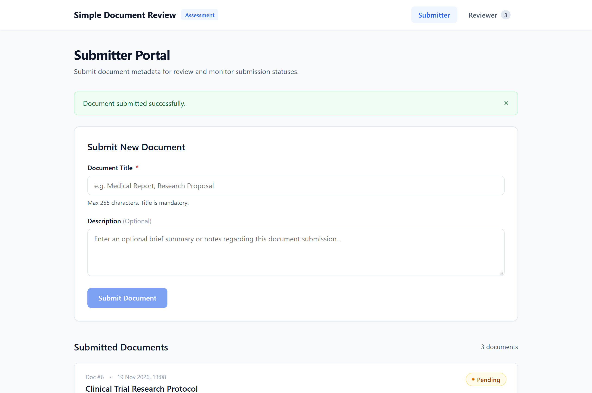
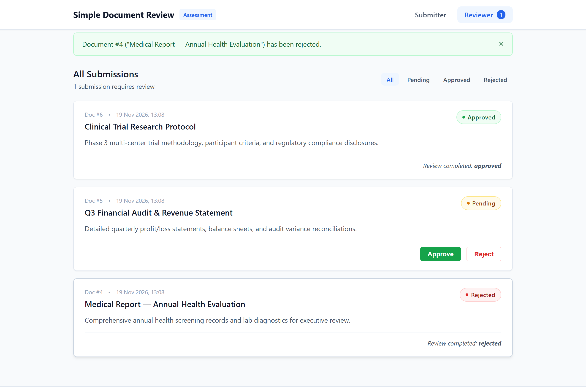

# Document Review System

A full-stack document review application built with Django REST Framework and React. Submitters can create document metadata, and reviewers can approve or reject pending submissions.

## Features

- Submit documents with a required title and optional description
- Automatically assign `pending` status to new submissions
- View submissions ordered from newest to oldest
- Filter submissions by pending, approved, or rejected status
- Approve or reject pending submissions
- Prevent an already approved or rejected document from being reviewed again
- Validate empty and whitespace-only titles
- Display loading, success, validation, and connection error states
- Persist submissions and review statuses in SQLite

## Tech Stack

### Backend

- Python
- Django 6.1.3
- Django REST Framework
- django-cors-headers
- SQLite

### Frontend

- React 19
- Vite 8
- JavaScript
- CSS
- Oxlint

## Project Structure

```text
.
├── backend/
│   ├── config/
│   │   ├── settings.py
│   │   ├── urls.py
│   │   └── wsgi.py
│   ├── documents/
│   │   ├── migrations/
│   │   ├── models.py
│   │   ├── serializers.py
│   │   ├── tests.py
│   │   ├── urls.py
│   │   └── views.py
│   ├── manage.py
│   ├── requirements.txt
│   └── manual_tests.http
├── frontend/
│   ├── public/
│   └── src/
│       ├── components/
│       ├── pages/
│       ├── services/
│       └── styles/
├── screenshots/
├── .env.example
└── README.md
```

## Prerequisites

- Python 3.12 or newer
- Node.js 20 or newer
- npm

## Installation

Clone the repository and change into the project directory:

```bash
git clone https://github.com/sanaataj290/predigle-fullstack-assessment.git
cd predigle-fullstack-assessment
```

### 1. Set Up the Backend

Create and activate a virtual environment:

**Windows (PowerShell):**

```powershell
cd backend
python -m venv venv
.\venv\Scripts\Activate.ps1
python -m pip install --upgrade pip
python -m pip install -r requirements.txt
```

**macOS/Linux:**

```bash
cd backend
python3 -m venv venv
source venv/bin/activate
python -m pip install --upgrade pip
python -m pip install -r requirements.txt
```

Apply migrations:

```bash
python manage.py migrate
```

Start the Django development server:

```bash
python manage.py runserver
```

The backend API is available at `http://localhost:8000/api/`.

### 2. Set Up the Frontend

Open a second terminal from the project root:

```bash
cd frontend
npm install
```

Create a local environment file:

```bash
cp .env.example .env
```

On Windows PowerShell, use:

```powershell
Copy-Item .env.example .env
```

The frontend environment file should contain:

```env
VITE_API_BASE_URL=http://localhost:8000/api
```

Start the Vite development server:

```bash
npm run dev
```

Open the URL printed by Vite, normally `http://localhost:5173`.

## Running the Application

1. Start Django on port `8000`.
2. Start Vite on port `5173`.
3. Open the frontend in a browser.
4. Use the **Submitter Portal** to create submissions.
5. Use the **Reviewer Queue** to approve or reject pending submissions.

## API Documentation

The API is served under `/api/documents/`.

### Get All Documents

```http
GET /api/documents/
```

Response:

```json
[
  {
    "id": 1,
    "title": "Medical Report",
    "description": "Annual health assessment",
    "status": "pending",
    "created_at": "2026-11-19T10:30:00Z"
  }
]
```

### Create a Document

```http
POST /api/documents/
Content-Type: application/json

{
  "title": "Medical Report",
  "description": "Annual health assessment"
}
```

The `description` field is optional. New documents always receive `pending` status, regardless of any status value supplied by the client.

Successful response status: `201 Created`

### Update a Document Status

```http
PATCH /api/documents/{id}/status/
Content-Type: application/json

{
  "status": "approved"
}
```

Permitted review values:

- `approved`
- `rejected`

A document can only be reviewed while it has `pending` status.

Successful response status: `200 OK`

### API Status Codes

| Status | Meaning |
|---|---|
| `200 OK` | Request completed successfully |
| `201 Created` | Document created successfully |
| `400 Bad Request` | Invalid title or review status |
| `404 Not Found` | Document ID does not exist |
| `405 Method Not Allowed` | HTTP method is not supported |

Manual examples are available in [backend/manual_tests.http](backend/manual_tests.http).

## Testing

### Backend Tests

From the backend virtual environment:

```bash
cd backend
python manage.py test -v 2
```

The suite verifies document creation, title validation, document retrieval, status updates, terminal review states, missing IDs, unsupported methods, and model behavior.

Check Django configuration without running the full test suite:

```bash
python manage.py check
```

### Frontend Build

```bash
cd frontend
npm run build
```

The production bundle is generated in `frontend/dist/`.

### Frontend Lint

```bash
cd frontend
npm run lint
```

## Environment Variables

| Variable | Location | Description |
|---|---|---|
| `VITE_API_BASE_URL` | Frontend | Base URL for Django API requests |
| `DEBUG` | Backend | Django debug setting for local development |
| `SECRET_KEY` | Backend | Django secret key |

Use different configuration values for production. Do not commit real secrets.

## Business Rules

- Title is required and cannot contain only whitespace.
- Description is optional and defaults to an empty string.
- New documents always begin with `pending` status.
- Clients cannot set or override a document's initial status.
- Only `approved` and `rejected` are permitted review statuses.
- A pending document can be approved or rejected once.
- Approved and rejected documents cannot be reviewed again.
- Submissions are displayed newest first.

## Screenshots

### Submission Form


### Submissions List



### Reviewer Page


### Updated Status



## Production Notes

This project is configured for local development and a technical assessment. Before deploying it to production:

- Replace the Django secret key and read it from an environment variable
- Set `DEBUG=False`
- Configure real `ALLOWED_HOSTS`
- Replace SQLite with a managed database if needed
- Configure CORS only for the deployed frontend origin
- Use HTTPS
- Build the frontend and serve it through Vite preview, a static host, or a reverse proxy
- Add authentication and authorization if reviewer actions must be restricted
- Add database migrations to the deployment process
- Avoid committing database files or runtime cache directories

## License

No license has been specified for this project. Add a license file if you intend to permit reuse or redistribution.
