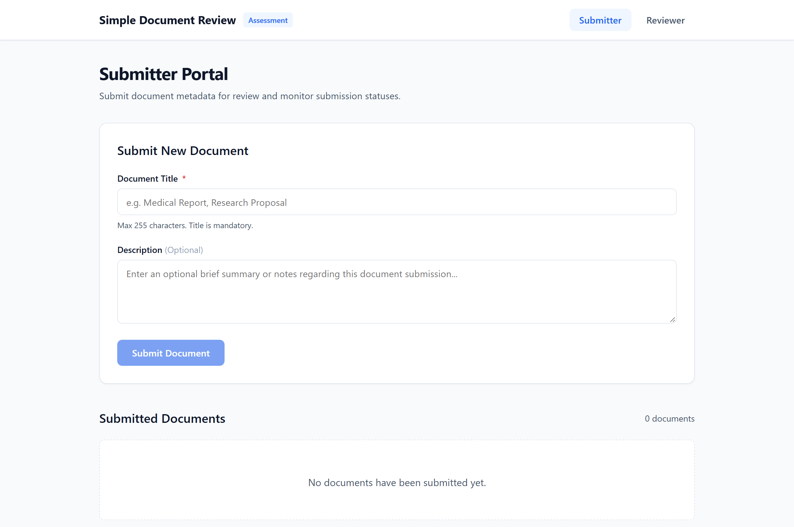
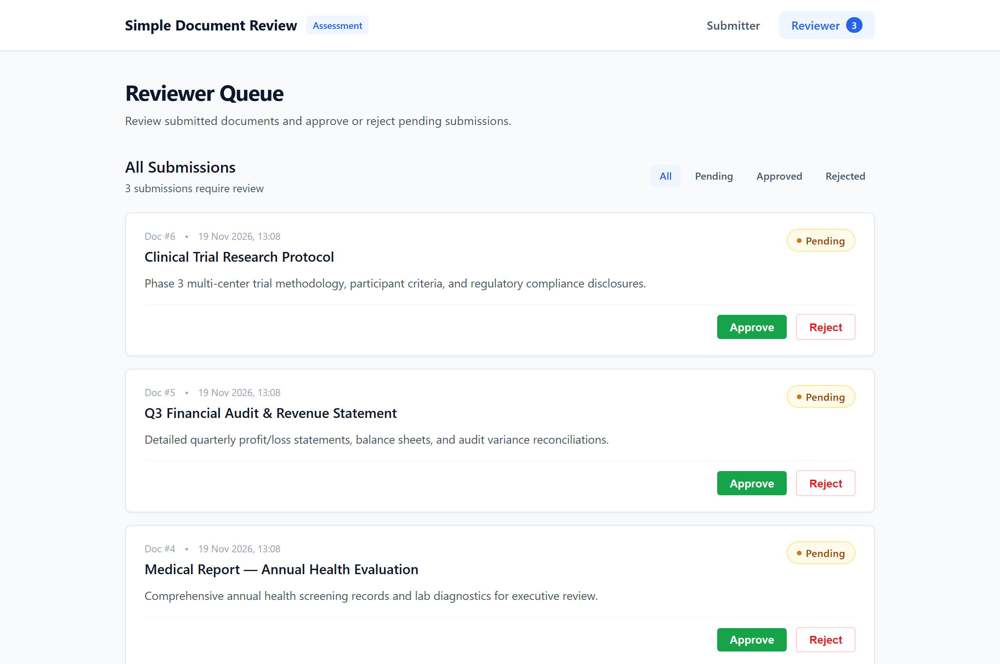

Predigle technical round - 2 assessment:
# Simple Document Review System

A full-stack web application developed as part of the **Predigle Full-Stack Development Technical Assessment**.

The application allows users to submit documents for review and enables reviewers to approve or reject submissions. It maintains document details and review statuses using a REST API and SQLite database.

## 1. Project Overview

The Simple Document Review System provides a straightforward way to manage document submissions and their review process.

Users can:
- Submit documents using a title and optional description.
- View all submitted documents.
- Track the current review status of each submission.

Reviewers can:
- View all submitted documents.
- Approve pending submissions.
- Reject pending submissions.
- View updated document statuses.

Each new submission is automatically assigned a **Pending** status.

## 2. Key Features

### Submitter
- Document submission form.
- Required title and optional description.
- Input validation.
- Submission confirmation.
- List of submitted documents.
- Display of submission date and review status.

### Reviewer
- View all submissions.
- Approve pending documents.
- Reject pending documents.
- View updated review statuses.

### Backend
- RESTful API endpoints.
- Document creation and retrieval.
- Status management.
- Input validation and error handling.
- SQLite database integration.

## 3. Technology Stack

| Technology | Purpose |
|---|---|
| Python | Backend programming language |
| Django | Backend web framework |
| Django REST Framework | REST API development |
| SQLite | Database |
| React | Frontend development |
| JavaScript | Frontend application logic |
| HTML and CSS | User interface and styling |
| HTTP and JSON | Frontend-backend communication |
| Django Test Framework | Backend automated testing |

## 4. System Architecture

The application follows a client-server architecture.

```text
             USER / SUBMITTER
                    |
                    v
             REACT FRONTEND
                    |
                    | HTTP Requests / JSON
                    v
             DJANGO REST API
                    |
                    v
             BUSINESS LOGIC
             AND VALIDATION
                    |
                    v
              SQLITE DATABASE
                    |
                    v
              REVIEWER PAGE
                    |
             +------+------+
             |             |
             v             v
          APPROVE        REJECT
             |             |
             +------+------+
                    |
                    v
             UPDATE STATUS
                    |
                    v
             DATABASE UPDATED
                    |
                    v
             REACT UI REFRESHED
```

### Application Workflow

1. The user enters a document title and optional description.
2. React sends the submission to the Django backend.
3. Django validates the input.
4. A valid submission is saved in the SQLite database with Pending status.
5. The frontend retrieves and displays the submitted documents.
6. The reviewer opens the reviewer page and views the submissions.
7. The reviewer approves or rejects a pending document.
8. Django updates the document status in the database.
9. React displays the updated status.

## 5. Database Model

The application uses SQLite to store document submissions.

### Document Model

| Field | Description |
|---|---|
| `id` | Unique document identifier |
| `title` | Required document title |
| `description` | Optional document description |
| `status` | Current review status |
| `created_at` | Document submission timestamp |

### Status Values

- `pending` – Document submitted and awaiting review.
- `approved` – Document approved by the reviewer.
- `rejected` – Document rejected by the reviewer.

New documents are automatically assigned Pending status.

Django ORM is used to interact with the database, while Django migrations manage database schema changes.

## 6. API Documentation

The backend exposes REST API endpoints for document management.

### 1. Create a Document

**Endpoint:**

`POST /api/documents/`

**Request Body:**

```json
{
  "title": "Project Proposal",
  "description": "Proposal submitted for review."
}
```

**Expected Response:** `201 Created`

A successful request creates a new document with Pending status.

### 2. Retrieve All Documents

**Endpoint:**

`GET /api/documents/`

**Expected Response:** `200 OK`

Returns the list of submitted documents, including their IDs, titles, descriptions, statuses and creation timestamps.

### 3. Update Document Status

**Endpoint:**

`PATCH /api/documents/<id>/status/`

**Request Body:**

```json
{
  "status": "approved"
}
```

To reject a document:

```json
{
  "status": "rejected"
}
```

**Expected Response:** `200 OK`

Updates the review status of the specified document.

### Common HTTP Status Codes

| Status Code | Meaning |
|---|---|
| 200 | Request successful |
| 201 | Document created successfully |
| 400 | Invalid request or validation error |
| 404 | Requested document not found |
| 500 | Internal server error |

## 7. Project Structure

```text
Simple-Document-Review-System/
│
├── backend/
│   ├── config/
│   ├── documents/
│   ├── manage.py
│   ├── requirements.txt
│   └── db.sqlite3
│
├── frontend/
│   ├── src/
│   ├── public/
│   ├── package.json
│   └── ...
│
├── screenshots/
│   ├── submission-form.png
│   ├── submissions-list.png
│   ├── reviewer-page.png
│   └── updated-status.png
│
├── .env.example
├── .gitignore
├── README.md
└── FINAL_QA_REPORT.md
```

*Note: The SQLite database file is generated locally and may be excluded from version control. Django migrations should be included in the repository.*

## 8. Installation and Setup

### Prerequisites

Install the following:

- Python
- Node.js and npm
- Git

### Step 1: Clone the Repository

```bash
git clone <YOUR_GITHUB_REPOSITORY_URL>
```

Navigate into the project:

```bash
cd Simple-Document-Review-System
```

### Step 2: Backend Setup

Navigate to the backend directory:

```bash
cd backend
```

Create a Python virtual environment:

```bash
python -m venv venv
```

Activate the virtual environment on Windows PowerShell:

```powershell
.\venv\Scripts\Activate.ps1
```

Install the dependencies:

```bash
pip install -r requirements.txt
```

Apply database migrations:

```bash
python manage.py migrate
```

Start the Django development server:

```bash
python manage.py runserver
```

Backend URL:

`http://127.0.0.1:8000/`

Keep this terminal running.

### Step 3: Frontend Setup

Open a second terminal and navigate to the frontend directory:

```bash
cd frontend
```

Install frontend dependencies:

```bash
npm install
```

Start the React development server:

```bash
npm run dev
```

Frontend URL:

`http://localhost:5173/`

The frontend and backend should run simultaneously.

## 9. Testing

The application can be tested using manual API requests and automated backend tests.

### Manual API Testing

The four core assessment scenarios are:

| Test Case | Expected Result |
|---|---|
| Successfully create a document | 201 Created |
| Reject an empty title | 400 Bad Request |
| Retrieve all submissions | 200 OK |
| Update document status | 200 OK |

Manual API testing can be performed using the VS Code REST Client extension with a `.http` request file.

### Automated Testing

The backend uses Django's built-in testing framework.

Run the automated tests from the backend directory:

```bash
python manage.py test
```

The automated tests should verify document creation, input validation, document retrieval and status updates.

Additional edge-case tests can cover invalid input, missing document IDs and database persistence.

Refer to `FINAL_QA_REPORT.md` for the actual test execution results and verification details.

## 10. Application Screenshots

The following screenshots demonstrate the main application functionality.

### Document Submission Form



### Submitted Documents List


### Reviewer Page



### Updated Document Status


## 11. Scope and Limitations

The application focuses on basic document submission and review management.

The following features are outside the assessment scope:

- User authentication and authorization.
- Actual document file uploads and storage.
- Complex database relationships.
- Production deployment.
- Advanced workflow management.

## 12. Conclusion

The Simple Document Review System demonstrates full-stack application development through React, Django REST Framework and SQLite.

It integrates frontend form handling, REST API communication, backend validation, database operations and document review workflows.

The project demonstrates the implementation of a functional full-stack application with basic testing, structured code organization and documentation.

---

**Project:** Simple Document Review System  
**Assessment:** Predigle Full-Stack Development Technical Assessment  
**Architecture:** React Frontend + Django REST API + SQLite Database
